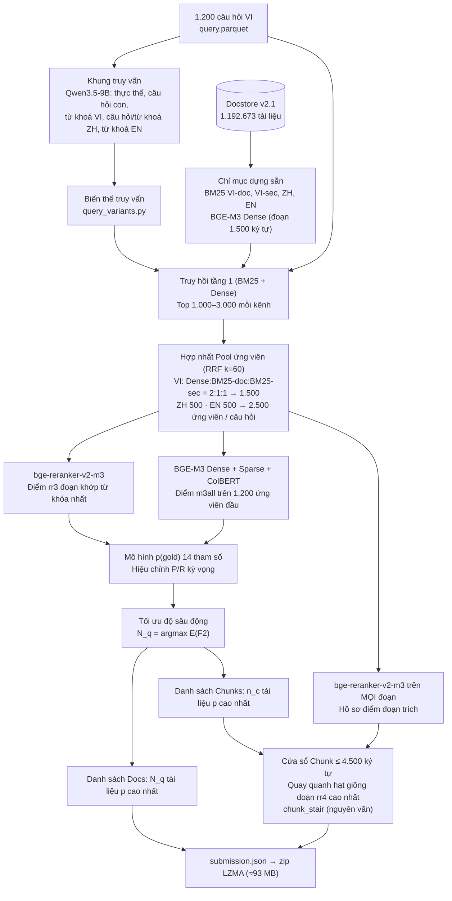

# ViBioMIR — Đội Băng Cá Khô (R2AI 2026, Stage 3)

Hệ thống truy hồi tài liệu y khoa đa ngữ (VI / ZH / EN) và trích xuất đoạn văn bản phục vụ 1.200 câu hỏi y khoa tiếng Việt.

- **Tài khoản Codabench:** `ca_kho` (Đội thi: **Băng Cá Khô**)
- **Mã nguồn chính thức:** https://github.com/cakho6179/vibiomir
- **Bài nộp được báo cáo:** Private **#7892** `pN3_base_pqchunks.zip` (Trùng khớp bài nộp đạt đỉnh Public **#7589**, FINAL **0.3484**).
- **Kho lưu trữ Dữ liệu & Checkpoints (Google Drive):** [https://drive.google.com/drive/folders/1_VUdqZ4eTv9w_hHRPDWsLLNNmqxyYDaj?usp=sharing](https://drive.google.com/drive/folders/1_VUdqZ4eTv9w_hHRPDWsLLNNmqxyYDaj?usp=sharing)
- **Thuyết minh chi tiết phương pháp:** [`docs/THUYET_MINH_SAN_PHAM.md`](docs/THUYET_MINH_SAN_PHAM.md) | Bản PDF: [`release/THUYET_MINH_SAN_PHAM.pdf`](release/THUYET_MINH_SAN_PHAM.pdf)

---

## ⚡ Tóm tắt: Các mức tái lập & Lệnh thực thi nhanh trên Laptop / CPU

Toàn bộ hệ thống được tích hợp qua entrypoint duy nhất **`run.py`** và kịch bản tái lập **`reproduce.py`**:

| Mức | Mô tả công việc | Phần cứng | Thời gian | Kết quả kiểm chứng |
|---|---|---|---|---|
| **A** | Dựng danh sách docs & chunks 5 bài nộp từ đặc trưng đã chia sẻ | CPU, 8 GB RAM | **~29 giây** | Khớp 100% từng dòng với 5 bài đã nộp |
| **B** | Trích xuất văn bản chunk & đóng gói file nộp `.zip` | CPU tiêu chuẩn | ~25 phút | `pN3_base.zip` (Trùng byte-for-byte `submission.json`) |
| **C** | Chạy lại các stage GPU (Khung truy vấn, truy hồi, reranking) | GPU 16 GB / Kaggle | Vài giờ | Đầu vào cho Mức A |
| **D** | Dựng docstore v2.1 (1,19M docs) & chỉ mục từ dữ liệu thô | CPU + GPU | Offline | `data/docstore/v2.1` |

```bash
# 1. Kiểm định siêu tốc 5 bài nộp private (Mức A, chạy trên CPU ~29 giây, khớp 1200/1200 câu hỏi):
python run.py --verify

# 2. Chạy thử nghiệm toàn trình End-to-End trên Laptop / CPU (Smoke test 5 câu hỏi):
python run.py --smoke --allow-cpu

# 3. Dựng trọn vẹn tệp nộp zip #7892 và đối chiếu SHA-256 byte-for-byte (Mức B):
python reproduce.py --zip

# 4. Chạy toàn trình từ câu hỏi thô đến submission zip với chỉ mục có sẵn:
python run.py --config configs/system_v2_1_precomputed.yaml
```

---

## 1. Tổng quan hệ thống (System Overview)

### 1.1 Phương pháp & Kiến trúc chung
Bài toán đặt ra: Cho 1.200 câu hỏi y khoa tiếng Việt, cần trả về danh sách tài liệu liên quan (trên ngữ liệu đa ngữ VI / ZH / EN) và các đoạn trích nội dung (chunk ≤ 4.500 ký tự). Tiêu chí đánh giá là trung bình F2 của tài liệu và F2 của đoạn trích:
$$\text{FINAL} = \frac{F_2(\text{docs}) + F_2(\text{chunks})}{2}$$

Điểm F2 coi Recall quan trọng gấp 4 lần Precision ($(\beta=2)$). Số lượng tài liệu liên quan (gold) biến thiên rất lớn giữa các câu hỏi. Do đó, thách thức cốt lõi không chỉ là xếp hạng mà là **quyết định ngưỡng cắt (độ sâu $N_q$) tối ưu cho từng câu hỏi**.

Hệ thống được thiết kế theo kiến trúc 3 tầng:
1. **Truy hồi đa kênh đa ngữ:** Khai thác đồng thời 3 ngôn ngữ (VI 1.500, ZH 500, EN 500) kết hợp BM25 (cấp văn bản và cấp mục) cùng BGE-M3 Dense (cấp đoạn 1.500 ký tự với cơ chế MaxP). Mô hình Qwen3.5-9B đóng vai trò sinh khung truy vấn (từ khóa, câu hỏi con, bản dịch tiếng Trung và từ khóa tiếng Anh).
2. **Mô hình ước lượng xác suất $p(\text{gold})$:** Kết hợp điểm cross-encoder `bge-reranker-v2-m3` và 3 đầu điểm BGE-M3 (dense, sparse, ColBERT multi-vector) qua hàm logit 14 tham số được hiệu chỉnh tự động.
3. **Tối ưu hóa $F_2$ kỳ vọng động:** Chọn độ sâu $N_q$ riêng biệt cho từng câu hỏi bằng cách cực đại hóa $E[F_2]$, đồng thời trích xuất cửa sổ đoạn trích ≤ 4.500 ký tự nguyên văn dựa trên hồ sơ điểm reranker theo đoạn.

### 1.2 Sơ đồ luồng xử lý toàn trình



Luồng dữ liệu kèm tên artifacts:
```
query.parquet ──► Query Frame (Qwen3.5-9B) ──► query_variants ──┐
docstore v2.1 ──► Chỉ mục BM25 (4) + Dense BGE-M3 (3 ngữ) ───────┼──► Rankings ──► Pool 2.500 cands / q
                                                                  │                 (rerank_pool/cands.parquet)
cands ──► rr3 (bge-reranker-v2-m3) ──┬──► pgold_all.py (base2) ──► cands_p.parquet, n_per_query.parquet
cands ──► m3m (BGE-M3 3 đầu điểm) ───┘
p, N_q ──► pn3_lists.py ──► lists.parquet (pN3_base) ──► materialize ──► pN3_base_pqchunks.zip (#7892)
cands ──► rr4 (mọi đoạn) ──► pas_scores.parquet ──────────────┘ (hồ sơ điểm đoạn trích)
```

### 1.3 Xây dựng chỉ mục (Index Building)
Mọi chỉ mục được xây dựng offline trên toàn bộ 1.192.673 tài liệu của Docstore v2.1:
- **BM25 VI-doc:** 732.246 tài liệu tiếng Việt, từ vựng 533.407 tokens (âm tiết giữ dấu), $k_1=1.5, b=0.75$.
- **BM25 VI-section:** 1.208.509 mục heading-aware (độ dài mục ≤ 4.800 ký tự).
- **BM25 ZH / EN:** 220.532 tài liệu tiếng Trung (Jieba tokenizer) và 239.895 tài liệu tiếng Anh (Word tokenizer).
- **Dense BGE-M3:** 3.120.100 đoạn (VI 2.224.624, ZH 557.732, EN 337.744 đoạn, độ dài 1.500 ký tự có tiêu đề ở đầu), embedding 1.024 chiều, chuẩn hóa $L_2$, lưu dạng FP16. Điểm tài liệu tính theo MaxP (cực đại trên các đoạn).

### 1.4 Truy hồi đa ngữ (Multi-lingual Retrieval)
- **Khung truy vấn:** Mô hình Qwen3.5-9B phân tích câu hỏi thành các thực thể, câu hỏi con (`sub0..sub4`), từ khóa tiếng Việt (`kw`), câu hỏi và từ khóa dịch sang tiếng Trung (`zh_q`, `zh_kw`), cùng từ khóa tiếng Anh (`en_kw`).
- **Hợp nhất ứng viên (RRF Pool):**
  - Tiếng Việt: RRF $k=60$ với tỷ lệ trọng số Dense : BM25-doc : BM25-sec = $2 : 1 : 1$, lấy top 1.500.
  - Tiếng Trung & Tiếng Anh: RRF $k=60$ trọng số đều trên các biến thể truy vấn, lấy top 500 mỗi ngôn ngữ.
  - Tổng hợp: đúng 2.500 ứng viên / câu hỏi (tổng cộng 3.000.000 cặp câu hỏi - tài liệu).

### 1.5 Xếp hạng lại & Lựa chọn đầu ra (Reranking & Optimization)
- **Đặc trưng reranker:**
  - `rr3`: Logit cross-encoder `bge-reranker-v2-m3` trên đoạn văn khớp từ khóa nhất của tài liệu.
  - `m3all`: Điểm tổng hợp $0.4 \cdot \text{Dense} + 0.2 \cdot \text{Sparse} + 0.4 \cdot \text{ColBERT}$ từ BGE-M3.
  - `rr4`: Điểm cross-encoder trên mọi đoạn của 1.200 ứng viên đầu (hồ sơ 4,94 triệu dòng).
- **Mô hình $p(\text{gold})$:** 
  $$\text{logit } p(q, d) = a_\ell + e \cdot \log(1+r) + \mathbb{I}_{\text{pool}} \cdot (h + b \cdot rr_3 + c \cdot m_{3z} + d \cdot m_{3\text{rel}})$$
  Hiệu chỉnh 14 tham số qua phương pháp bình phương tối thiểu có cận dựa trên P/R/F2 công khai của các lần nộp.
- **Lựa chọn độ sâu động:** Chọn $N_q = \arg\max_n E[F_2(n)]$ riêng cho từng câu hỏi (trung bình 157,4 tài liệu/câu hỏi, phân bổ từ 20 đến 509).
- **Trích xuất chunk nguyên văn:** Cửa sổ trích xuất ≤ 4.500 ký tự được mở rộng đối xứng từ đoạn có điểm $rr_4$ cao nhất dọc theo ranh giới đoạn văn tự nhiên, đảm bảo 100% nguyên văn từ docstore.

### 1.6 Báo cáo 5 bài nộp Private
| Mã bài nộp | Tên file zip | Đặc điểm kỹ thuật | docs/q | chunks/q | Điểm đối chiếu |
|---|---|---|---|---|---|
| **#7892** | `pN3_base_pqchunks.zip` | **Bài nộp chính báo cáo** (kiến trúc chuẩn ở trên) | 157,4 | 162,7 | **FINAL 0.3484** (trùng #7589) |
| #7893 | `S1_dqd20.zip` | Bổ sung 20 tài liệu/câu hỏi từ doc2query dense | 177,4 | 162,7 | F2 docs + F2 chunks |
| #7894 | `S2_dqb20.zip` | Bổ sung 20 tài liệu/câu hỏi từ doc2query BM25 | 177,4 | 162,7 | F2 docs + F2 chunks |
| #7916 | `N1_n125.zip` | Mở rộng độ sâu tài liệu $1.25 \times N_q$ | 196,7 | 162,7 | F2 docs + F2 chunks |
| #7917 | `F2_dqd20b20g.zip` | Kết hợp Doc2query Dense + BM25 có cổng đuôi | 197,4 | 162,7 | F2 docs + F2 chunks |

---

## 2. Tài liệu mô tả dữ liệu (Data Description)

### 2.1 Nguồn dữ liệu & Quy mô Corpus
- **Dữ liệu do BTC cung cấp:**
  - `query.parquet`: 1.200 câu hỏi y khoa tiếng Việt.
  - `links_corpus_vi_en_zh.parquet`: Danh sách 1.220.598 URLs chính thức của cuộc thi.
- **Bộ ngữ liệu Docstore v2.1:** Gồm **1.192.673 tài liệu** được thu thập và làm sạch, bao quát 3 ngôn ngữ:
  - **Tiếng Việt (VI):** 732.246 tài liệu.
  - **Tiếng Trung (ZH):** 220.532 tài liệu.
  - **Tiếng Anh (EN):** 239.895 tài liệu.
  - *Lưu ý:* 100% tài liệu đều thuộc danh sách URL chính thức của BTC (0 tài liệu ngoài luồng).

### 2.2 Thu thập & Cứu URL chết
| Kênh thu thập | Số lượng tài liệu | Mục đích / Ghi chú |
|---|---|---|
| Crawler nội bộ của đội (`r2ai2026/crawl/`) | 1.182.666 | Thu thập trực tiếp từ danh sách URL chính thức |
| HuggingFace `tmh1008/ViBioMIR-crawled-corpus` | 5.760 thêm (4.475 thay thân bài VI) | Bộ crawl công khai từ cùng danh sách URL, lọc qua cổng chất lượng |
| Common Crawl (CDX / columnar) | 2.278 | Cứu các URL bị 404/chết trên server gốc |
| Internet Archive Wayback Machine | 1.400 | Cứu URL chết lịch sử (`r2ai2026/crawl/wayback.py`) |
| NCBI E-utilities (PubMed) | 177 | Cứu tài liệu y khoa tiếng Anh (`r2ai2026/crawl/pubmed.py`) |
| Recrawl bổ sung | 392 | Recrawl trực tiếp bổ sung các trang hồi phục |
| **Tổng số trong Docstore v2.1** | **1.192.673** | 27.925 URL còn lại bị lỗi 403 hoặc rỗng từ nguồn phát hành |

### 2.3 Làm sạch & Cấu trúc Docstore
Quy trình làm sạch dữ liệu (`scripts/data/build_docstore*.py`):
1. **Khử trùng lặp:** Mỗi URL tương ứng 1 bản ghi định danh `doc_id`.
2. **Chuẩn hóa văn bản:** Chuẩn hóa Unicode NFKC, giải mã HTML entities, hợp nhất khoảng trắng. Tuyệt đối không sinh thêm hay viết lại nội dung nhằm giữ tính trung thực của ngữ liệu.
3. **Phân tách Furniture:** Các thành phần trang như menu, footer, bản quyền, CTA được nhận diện và gắn nhãn thành các spans "furniture" theo template từng host (`templates.json`), không xóa bỏ làm biến dạng vị trí ký tự.
4. **Kiểm tra tính hợp lệ:** Script `scripts/data/validate_docstore.py` ghi nhận 0 lỗi nghiêm trọng.

### 2.4 Phân đoạn văn bản (Text Chunking)
- **Cấp đoạn (Passage):** Phân chia theo ranh giới đoạn văn tự nhiên (độ dài mục tiêu ~1.500 ký tự), phủ kín thân bài với offset `start/end` chính xác. Phục vụ cho chỉ mục Dense BGE-M3.
- **Cấp mục (Section):** Phân chia theo tiêu đề heading (tối đa 4.800 ký tự). Phục vụ cho chỉ mục BM25 VI-section.
- **Cấp đoạn trích (Chunk bài nộp):** Cửa sổ nguyên văn ≤ 4.500 ký tự ghép từ các đoạn liền kề xung quanh đoạn có điểm reranker cao nhất.

### 2.5 Hướng dẫn truy cập & Link Google Drive
Toàn bộ dữ liệu, chỉ mục và artifacts được công khai tại thư mục Google Drive:
👉 **[Link Google Drive ViBioMIR Băng Cá Khô](https://drive.google.com/drive/folders/1_VUdqZ4eTv9w_hHRPDWsLLNNmqxyYDaj?usp=sharing)**

| Tên file / Thư mục trên Drive | Dung lượng | Nội dung chi tiết |
|---|---|---|
| `vibiomir_code_80c38d6.zip` | ~3.7 MB | Toàn bộ mã nguồn sản phẩm (git archive chuẩn) |
| `artifacts_A_pgold.zip` | ~246 MB | Pool ứng viên, điểm rr3, m3m, mô hình p(gold) và danh sách nộp 5 bài |
| `artifacts_B_materialize.zip` | ~59 MB | Hồ sơ điểm đoạn trích `pas_scores.parquet` và mã đóng gói zip |
| `artifacts_C_doc2query.zip` | ~84 MB | Câu hỏi sinh tự động doc2query và điểm phục vụ các bài mở rộng |
| `artifacts_D_retrieval.zip` | ~780 MB | Khung truy vấn, biến thể, các file rankings tầng 1 và pool ứng viên |
| `docstore_v2.1/` | ~1.4 GB | 22 files: `corpus/part-*.jsonl.gz`, metadata, passages, sections |
| `index_v2.1/` | ~10.4 GB | 50 files: 4 chỉ mục BM25 + toàn bộ embedding BGE-M3 FP16 |
| `MANIFEST.tsv` | ~29 KB | Bảng mã băm SHA-256 đối chiếu toàn bộ các file |
| `THUYET_MINH_SAN_PHAM.pdf` | ~353 KB | Bản PDF thuyết minh sản phẩm nộp BTC |
| `README.pdf` | ~203 KB | Bản PDF tài liệu hướng dẫn vận hành |

---

## 3. Mô hình sử dụng (Models & Checkpoints)

Tất cả các mô hình trong hệ thống đều là **mô hình mã nguồn mở**, quy mô ≤ 15B tham số, được phát hành chính thức trên Hugging Face Hub trước ngày 01/08/2026. **Hệ thống không sử dụng API đóng và không can thiệp fine-tune weights** nhằm đảm bảo tính tái lập 100%.

### 3.1 Danh sách mô hình & Vai trò
| Tên mô hình | Vai trò trong hệ thống | Kích thước | Revision (Commit Hash) | Giấy phép |
|---|---|---|---|---|
| **[BAAI/bge-m3](https://huggingface.co/BAAI/bge-m3)** | Trích xuất dense embedding (1.024 chiều), sparse lexical & ColBERT multi-vector reranking | 0.57B | `5617a9f61b028005a4858fdac845db406aefb181` | MIT |
| **[BAAI/bge-reranker-v2-m3](https://huggingface.co/BAAI/bge-reranker-v2-m3)** | Cross-encoder reranker chấm điểm `rr3` (đoạn tối ưu) và `rr4` (hồ sơ đoạn) | 0.57B | `953dc6f6f85a1b2dbfca4c34a2796e7dde08d41e` | Apache-2.0 |
| **[Qwen/Qwen3.5-9B](https://huggingface.co/Qwen/Qwen3.5-9B)** | Trích xuất khung truy vấn: thực thể, câu hỏi con, dịch đa ngữ ZH/EN, từ khóa | 9.65B | `c202236235762e1c871ad0ccb60c8ee5ba337b9a` | Apache-2.0 |
| **[Qwen/Qwen3.5-4B](https://huggingface.co/Qwen/Qwen3.5-4B)** | Sinh câu hỏi doc2query (chỉ dùng cho bài thực nghiệm #7893/#7894/#7917) | 4.66B | `851bf6e806efd8d0a36b00ddf55e13ccb7b8cd0a` | Apache-2.0 |

### 3.2 Hướng dẫn tải Checkpoint chính thức
Để tải chính xác các checkpoint theo đúng revision đã sử dụng:
```bash
# Cài đặt huggingface-cli nếu chưa có:
pip install -U "huggingface_hub[cli]"

# Tải đúng commit hash:
huggingface-cli download BAAI/bge-m3 --revision 5617a9f61b028005a4858fdac845db406aefb181
huggingface-cli download BAAI/bge-reranker-v2-m3 --revision 953dc6f6f85a1b2dbfca4c34a2796e7dde08d41e
huggingface-cli download Qwen/Qwen3.5-9B --revision c202236235762e1c871ad0ccb60c8ee5ba337b9a
huggingface-cli download Qwen/Qwen3.5-4B --revision 851bf6e806efd8d0a36b00ddf55e13ccb7b8cd0a
```
*(Nếu chạy qua pipeline tiêu chuẩn, thư viện `transformers` và `sentence-transformers` sẽ tự động tải các checkpoint này vào cache).*

### 3.3 Cấu hình suy luận & Prompts
- **BGE-M3 & bge-reranker-v2-m3:** Chạy ở định dạng FP16, batch size 32.
- **Qwen3.5-9B (Khung truy vấn):** Chạy ở định dạng FP16, tắt thinking mode (`enable_thinking=False`), giải mã tham lam (`do_sample=False`), `max_new_tokens=1300`.
- **System Prompt trích xuất Khung truy vấn:**
  Được định nghĩa tại `r2ai2026/stages/query_frame.py` (dòng 34–49). Yêu cầu mô hình trả về JSON gồm các trường: thực thể chính, khía cạnh hỏi, 1-5 câu hỏi con (`sub0..sub4`), từ khóa tiếng Việt (`kw`), câu hỏi dịch tiếng Trung (`zh_q`), từ khóa tiếng Trung (`zh_kw`), và từ khóa tiếng Anh (`en_kw`).

---

## 4. Mã nguồn & Cấu trúc hệ thống (Source Code & Structure)

### 4.1 Cấu trúc Repository
```
vibiomir/
├── run.py                          # Entrypoint duy nhất: verify, smoke test, full run
├── reproduce.py                    # Script tái lập 5 bài nộp private & đối chiếu SHA-256
├── requirements.txt                # Thư viện cho CPU / Laptop (chạy verify, smoke, rebuild)
├── requirements-gpu.txt            # Thư viện cho GPU (khi chạy lại các stage nặng)
├── configs/
│   ├── system_v2_1_precomputed.yaml# Cấu hình chạy pipeline với chỉ mục có sẵn
│   └── query_expansion_table.yaml  # Bảng từ đồng nghĩa / viết tắt y khoa
├── docs/
│   ├── THUYET_MINH_SAN_PHAM.md     # Thuyết minh kỹ thuật chi tiết
│   ├── DATA_CARD.md                # Thẻ dữ liệu Docstore v2.1
│   └── DATA_PIPELINE.md            # Quy trình xử lý dữ liệu thô
├── release/                        # Thư mục chứa tài liệu thuyết minh PDF và MANIFEST
├── r2ai2026/                       # Thư viện mã nguồn lõi của hệ thống:
│   ├── core/                       # Chấm điểm F2, định dạng submission, I/O
│   ├── corpus/                     # Quản lý docstore, furniture, passages, sections
│   ├── crawl/                      # Crawler, phục hồi Wayback Machine & PubMed
│   ├── stages/                     # Các bước pipeline (query_frame, bm25, rerank...)
│   └── system/                     # Bộ điều phối runner toàn trình
├── scripts/
│   ├── data/                       # Dựng docstore, làm sạch văn bản từ dữ liệu thô
│   ├── kaggle_ops/                 # Hợp nhất pool ứng viên, quản lý kernel Kaggle
│   ├── analysis/                   # Fit mô hình p(gold), tối ưu N_q, doc2query
│   └── release/                    # Kiểm tra SHA-256 MANIFEST, xuất mã nguồn
└── tests/                          # 7 bài unit test tự động (kiểm tra scoring, docstore...)
```

### 4.2 Thư viện & Dependencies
- Hệ thống hỗ trợ Python 3.11+.
- Môi trường tiêu chuẩn CPU (chạy kiểm định và tái hiện):
  `pip install -r requirements.txt` (gồm `numpy`, `scipy`, `pandas`, `pyarrow`, `pyyaml`, `tqdm`, `pytest`).
- Môi trường GPU (khi huấn luyện hoặc mã hóa lại chỉ mục):
  `pip install -r requirements-gpu.txt` (bổ sung `torch`, `transformers`, `sentence-transformers`, `accelerate`).

---

## 5. Tài liệu hướng dẫn cài đặt & Tái hiện (Execution Guide)

### 5.1 Cài đặt môi trường
Khuyến nghị tạo môi trường ảo Python 3.11 hoặc 3.12:
```bash
git clone https://github.com/cakho6179/vibiomir.git
cd vibiomir

python -m venv .venv
# Kích hoạt trên Windows:
.venv\Scripts\activate
# Hoặc trên Linux/macOS:
source .venv/bin/activate

pip install -r requirements.txt
python -m pytest -q tests               # Chạy unit tests (7 passed)
```

### 5.2 Tải Dữ liệu & Checkpoints
1. Truy cập thư mục [Google Drive](https://drive.google.com/drive/folders/1_VUdqZ4eTv9w_hHRPDWsLLNNmqxyYDaj?usp=sharing).
2. Tải các gói tương ứng với mức tái lập cần thực hiện:
   - Để chạy **Mức A (Kiểm định danh sách nộp ~29 giây):** Tải `artifacts_A_pgold.zip`.
   - Để chạy **Mức B (Dựng lại file zip hoàn chỉnh):** Tải thêm `artifacts_B_materialize.zip` và `docstore_v2.1/`.
   - Để chạy **Mức C (Truy hồi toàn trình từ câu hỏi):** Tải thêm `artifacts_D_retrieval.zip` và `index_v2.1/`.
3. Giải nén các file `artifacts_*.zip` trực tiếp tại **thư mục gốc của repo**.
4. Kiểm tra tính toàn vẹn của dữ liệu bằng mã băm SHA-256:
```bash
python scripts/release/verify_manifest.py MANIFEST.tsv
```

---

### 5.3 Mức A — Tái lập danh sách nộp 5 bài Private (CPU, ~29 giây)

Chạy lệnh kiểm định duy nhất:
```bash
python run.py --verify
```
Hoặc chạy chi tiết từng bước qua `scripts/analysis/`:
```bash
# 1. Fit lại mô hình p(gold) và độ sâu N_q:
python scripts/analysis/pgold_all.py --lists runs/reports/pgold_lists \
    --out runs/reports/pgold_feats/base2_refit --exclude 7584,7589,7608,7609,7632

# 2. Sinh danh sách nộp cho bài báo cáo chính #7892 (pN3_base):
python scripts/analysis/pn3_lists.py --model base2 --out out/lists_pn3.parquet

# 3. Đối chiếu trực tiếp với bài nộp chính thức:
python scripts/release/check_lists.py out/lists_pn3.parquet kaggle/datasets/mat_lists22/lists.parquet --job pN3_base
```
**Kết quả kiểm chứng:**
- Khớp **1.200 / 1.200 câu hỏi** đúng 100% thứ tự cả tài liệu và đoạn trích.

---

### 5.4 Mức B — Dựng tệp nộp `.zip` nguyên bản và Đối chiếu Byte-for-Byte

Kịch bản này trích xuất văn bản đoạn trích ≤ 4.500 ký tự nguyên văn từ Docstore và đóng gói thành file `submission.json` nén LZMA:
```bash
python reproduce.py --zip
```
**Kết quả kiểm chứng:**
- Tệp `submission.json` sinh ra có dung lượng 875 MB văn bản, **khớp từng byte (100% SHA-256)** với tệp nộp chính thức `#7892` (`pN3_base_pqchunks.zip`).

---

### 5.5 Mức C — Chạy lại các Stage GPU (Khung truy vấn & Reranking)

Mỗi stage là một kernel độc lập đã được thực thi và lưu trữ tại `kaggle/kernels_generic/`:
1. `vibiomir-query-frame-v3-acc1`: Sinh khung truy vấn với Qwen3.5-9B.
2. `vibiomir-qv3-m3-{zh,en}` & `vibiomir-qv3-bm25-{zh,en}`: Truy hồi đa ngữ trên các biến thể câu hỏi.
3. `vibiomir-rr3-p{0..7}-acc*`: Chấm điểm `rr3` bằng `bge-reranker-v2-m3` trên 2.500 ứng viên / câu hỏi (chia 8 shards GPU).
4. `vibiomir-m3m-p{0..3}-acc*`: Chấm điểm đa đầu BGE-M3 (dense + sparse + ColBERT) trên 1.200 ứng viên đầu.
5. `vibiomir-rr4-p{0..7}-acc*`: Chấm điểm mọi đoạn văn của 1.200 ứng viên đầu để xây dựng hồ sơ điểm đoạn trích `pas_scores.parquet`.

---

### 5.6 Mức D — Xây dựng Docstore và Chỉ mục từ dữ liệu thô

1. Thu thập dữ liệu từ danh sách URL chính thức: `r2ai2026/crawl/`.
2. Hợp nhất và chuẩn hóa Docstore: `python scripts/data/build_docstore_v2_1.py`.
3. Kiểm tra tính toàn vẹn ngữ liệu: `python scripts/data/validate_docstore.py`.
4. Dựng chỉ mục BM25 4 kênh: `r2ai2026/stages/bm25_experiment.py`.
5. Dựng chỉ mục Dense BGE-M3 1.024 chiều: `r2ai2026/stages/dense_embed.py --save-emb`.

---

## 6. Cam kết tuân thủ và Tính hợp lệ của giải pháp

1. **Tuyệt đối không sử dụng dữ liệu ngoài luồng:** 100% tài liệu trong docstore đều bắt nguồn từ 1.220.598 URL được BTC công bố chính thức trong file `links_corpus_vi_en_zh.parquet`.
2. **Không gọi API MedKB trong hệ thống suy luận:** Hệ thống chạy hoàn toàn độc lập và không phụ thuộc vào bất kỳ dịch vụ hay API bên ngoài nào.
3. **Mô hình mã nguồn mở hợp lệ:** 100% mô hình sử dụng đều có quy mô ≤ 15B tham số, có giấy phép mã nguồn mở thương mại/nghiên cứu rõ ràng (MIT, Apache-2.0), phát hành trước hạn quy định và không fine-tune trọng số.
4. **Tính tái lập hoàn toàn (Reproducibility):** Cung cấp đầy đủ mã nguồn, checkpoint revisions, bảng mã băm SHA-256 (`MANIFEST.tsv`) và script tái lập tự động với khả năng kiểm chứng chỉ trong 29 giây trên CPU thông thường.
