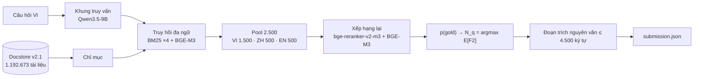

# ViBioMIR · đội Băng Cá Khô

**Truy hồi tài liệu y khoa đa ngữ (Việt · Trung · Anh) và trích đoạn nguyên văn cho câu hỏi y khoa tiếng Việt.**
Road to AI 2026 · Chặng 3.

Với mỗi câu hỏi, hệ thống trả về hai thứ: danh sách tài liệu liên quan, lấy từ kho 1,19 triệu trang y khoa, và các đoạn trích nguyên văn ≤ 4.500 ký tự.
Điểm là trung bình F2 của tài liệu và F2 của đoạn trích. Vì F2 coi trọng recall, câu hỏi khó nhất không phải "xếp hạng thế nào" mà là **lấy bao nhiêu tài liệu cho từng câu hỏi**. Hệ thống trả lời câu đó bằng một mô hình xác suất và độ sâu tối ưu riêng cho mỗi câu hỏi.

| | |
|---|---|
| Đội | Băng Cá Khô · Codabench `ca_kho` |
| Mã nguồn | https://github.com/cakho6179/vibiomir |
| Dữ liệu, chỉ mục, đầu ra trung gian | [thư mục chia sẻ](https://drive.google.com/drive/folders/1_VUdqZ4eTv9w_hHRPDWsLLNNmqxyYDaj?usp=sharing) |
| Tài liệu kỹ thuật | [`docs/THUYET_MINH_SAN_PHAM.md`](docs/THUYET_MINH_SAN_PHAM.md) · [`docs/DATA_CARD.md`](docs/DATA_CARD.md) |

---

## Kết quả

| Bài | FINAL | Docs P / R / F2 | Chunks P / R / F2 |
|---|---|---|---|
| Public #7589 (`pN3_base`) | **0,3484** | 0,2331 / 0,5620 / 0,3964 | 0,1791 / 0,4226 / 0,3004 |
| Private #7916 (`N1_n125`, trên bảng private) | **0,3374** | 0,2038 / 0,5441 / 0,3836 | 0,1783 / 0,3802 / 0,2911 |
| Private #7892 (`pN3_base`, cùng file với #7589) | 0,3345 | 0,2297 / 0,4935 / 0,3779 | 0,1783 / 0,3802 / 0,2911 |
| Private #7893 · #7894 · #7917 (biến thể doc2query) | 0,3232 · 0,3181 · 0,3054 | | |

#7916 và #7892 là cùng một hệ thống. #7916 lấy 1,25 × N_q tài liệu thay cho N_q; phần đoạn trích giống hệt nhau.

---

## Demo

```bash
python run.py --web          # mở http://127.0.0.1:8765
```

Web demo phát lại hệ thống trên **bất kỳ câu nào trong 1.200 câu hỏi** của cuộc thi. Ở mỗi câu, demo **theo dõi một tài liệu thật** xuyên suốt 10 bước:

| | Bước | Trang demo cho thấy |
|---|---|---|
| 1 | Kiến trúc | sơ đồ toàn hệ thống; bấm vào khối nào thì tới bước đó |
| 2 | Thu thập dữ liệu | 1.220.598 URL của BTC → các nguồn → 1.192.673 tài liệu; nguồn của tài liệu đang theo dõi |
| 3 | Docstore | bản ghi thật: URL, độ dài, đoạn, mục, khung trang (tô đỏ, được đánh dấu chứ không xoá), toàn văn |
| 4 | Chỉ mục | các chỉ mục chứa tài liệu, và số đơn vị của nó trong từng chỉ mục, đếm trực tiếp trong tệp chỉ mục |
| 5 | Khung truy vấn | từ khoá VI, câu hỏi và từ khoá ZH, từ khoá EN do Qwen3.5-9B sinh ra; các biến thể truy vấn |
| 6 | Truy hồi và pool | hạng của tài liệu trong từng kênh (BM25, BGE-M3), rồi hạng trong pool 2.500 ứng viên |
| 7 | Xếp hạng lại | điểm cross-encoder, ba đầu điểm BGE-M3, và điểm rr4 trên từng đoạn của tài liệu |
| 8 | p(gold) và độ sâu | đường cong F2 kỳ vọng theo số tài liệu, các mốc N_q / 1,25·N_q / n_c, ngôn ngữ của tài liệu được chọn |
| 9 | Chunk | từng vòng nở của cửa sổ quanh đoạn tốt nhất, và lát cắt nguyên văn được nộp |
| 10 | Bài nộp | mục `submission.json` của câu hỏi |

**Mỗi trang tự đối chiếu với bài đã nộp.** Demo tính lại đường cong F2 bằng đúng hàm và tham số của lần chạy, rồi kiểm:
- N_q bằng số tài liệu đã nộp;
- danh sách tài liệu #7892 và #7916 khớp;
- danh sách đoạn trích khớp;
- hàm cắt đoạn trích của hệ thống cho đúng văn bản đã nộp.

Kiểm trên 150 câu ngẫu nhiên: cả 150 câu khớp. Văn bản của 6.000 đoạn trích trong demo trùng từng ký tự với file đã nộp.

Câu gợi ý: **#401** (xét nghiệm IgE: 61/74 tài liệu được chọn là tiếng Trung), **#556** (Kwashiorkor: tài liệu tiếng Anh nhiều nhất), **#1** (câu dài, 324 tài liệu).
Lệnh `python run.py --demo --qid 401` ghi cùng trang đó thành tệp HTML chạy offline: `out/demo/q401.html`.

---

## Kiến trúc



| Tầng | Cách làm |
|---|---|
| **Khung truy vấn** | Qwen3.5-9B đọc câu hỏi một lần (giải mã tham lam) và trả về thực thể, câu hỏi con, từ khoá VI, câu hỏi và từ khoá ZH, từ khoá EN. Từ đó sinh 12.531 biến thể truy vấn cho 1.200 câu. |
| **Chỉ mục** (dựng một lần) | BM25: VI theo tài liệu (732.246), VI theo mục (1.208.509 mục), ZH (tách từ jieba), EN. BGE-M3 dense: 3.120.100 vector; VI, EN dùng đoạn ≤ 1.500 ký tự, ZH dùng đoạn 500 ký tự chồng 100; điểm tài liệu = đoạn tốt nhất. |
| **Pool** | 12 danh sách kênh × biến thể được gộp bằng Reciprocal Rank Fusion (k = 60). VI có trọng số dense : BM25-doc : BM25-mục = 2 : 1 : 1. Pool giữ 1.500 VI + 500 ZH + 500 EN mỗi câu hỏi. |
| **Xếp hạng lại** | `rr3`: bge-reranker-v2-m3 trên đoạn trùng từ nhất với câu hỏi. `m3all` = 0,4 dense + 0,2 sparse + 0,4 ColBERT trên 1.200 ứng viên đầu. `rr4`: reranker trên mọi đoạn, dùng để đặt đoạn trích. |
| **p(gold)** | logit p = a<sub>ngôn ngữ</sub> + e·log(1+hạng) + h + b·rr3 + c·m3z + d·m3rel. 14 tham số được hiệu chỉnh sao cho P/R/F2 tổng hợp dự đoán khớp P/R/F2 public của 27 bài của đội. Không dùng nhãn từng cặp. |
| **Độ sâu** | Tài liệu: N_q = argmax E[F2(n)] trên ứng viên xếp theo p, trung bình 157,4. Đoạn trích: n_c với p<sub>c</sub> = 0,77·p, trung bình 162,7. |
| **Đoạn trích** | Tài liệu ≤ 4.500 ký tự thì lấy trọn. Ngược lại, hạt giống là đoạn có rr4 cao nhất. Mỗi vòng thử nối thêm một đoạn phía sau và một đoạn phía trước; phép thử nào vẫn ≤ 4.500 ký tự thì được giữ. |

**Vì sao đa ngữ.** Hai bài thăm dò cùng nộp 5.000 tài liệu cho mỗi câu hỏi:
- chỉ tiếng Việt: recall tài liệu **0,7317**;
- VI 3.000 + ZH 1.000 + EN 1.000: recall **0,936**.

Ít nhất ~20% tài liệu liên quan nằm ở tiếng Trung và tiếng Anh.

Chi tiết, tham số và prompt: [`docs/THUYET_MINH_SAN_PHAM.md`](docs/THUYET_MINH_SAN_PHAM.md).

---

## Dữ liệu: thu thập và docstore

Đội chỉ lấy văn bản của **1.220.598 URL chính thức** do BTC công bố.

| Nguồn | Tài liệu | Cách lấy |
|---|---|---|
| crawler của đội | 1.182.666 | crawl bất đồng bộ, giới hạn kết nối mỗi host, tôn trọng `robots.txt`; trích nội dung bằng trafilatura, lui về lxml khi lỗi; tiến độ lưu SQLite nên dừng và chạy tiếp được (`r2ai2026/crawl/`) |
| dữ liệu từ Hugging Face | 5.760 thêm, 4.475 thay thân bài VI | bộ crawl công khai của cùng danh sách URL, qua cổng chất lượng |
| Common Crawl | 2.278 | tra chỉ mục CDX, lấy bản ghi WARC theo byte |
| Internet Archive Wayback | 1.400 | bản lưu cho các host chặn crawl |
| recrawl trực tiếp | 392 | |
| NCBI E-utilities | 177 | trang PubMed |
| **Docstore v2.1** | **1.192.673** | VI 732.246 · ZH 220.532 · EN 239.895; còn 27.925 URL không lấy được (403, rỗng) |

Mỗi tài liệu là một bản ghi `{id, url, t, x}` (tiêu đề, thân bài). Kèm theo là ba bảng offset:
- `passages`: 3.607.930 đoạn theo đoạn văn;
- `sections`: 1.654.080 mục theo heading;
- `furniture`: khung trang (menu, footer, CTA…), được **đánh dấu chứ không xoá**.

Văn bản được chuẩn hoá (entity, Unicode, khoảng trắng) nhưng không viết lại. Vì thế mọi đoạn trích nộp đi đều là lát cắt nguyên văn của thân bài. Xem [`docs/DATA_CARD.md`](docs/DATA_CARD.md).

---

## Mô hình

Tất cả là mô hình mở, ≤ 15B tham số, phát hành trước 01/08/2026. Không dùng API hay mô hình đóng; không fine-tune.

| Mô hình | Vai trò | Revision |
|---|---|---|
| [Qwen/Qwen3.5-9B](https://huggingface.co/Qwen/Qwen3.5-9B) | khung truy vấn | `c202236235762e1c871ad0ccb60c8ee5ba337b9a` |
| [BAAI/bge-m3](https://huggingface.co/BAAI/bge-m3) | chỉ mục dense, m3all | `5617a9f61b028005a4858fdac845db406aefb181` |
| [BAAI/bge-reranker-v2-m3](https://huggingface.co/BAAI/bge-reranker-v2-m3) | rr3, rr4 | `953dc6f6f85a1b2dbfca4c34a2796e7dde08d41e` |
| [Qwen/Qwen3.5-4B](https://huggingface.co/Qwen/Qwen3.5-4B) | doc2query (chỉ #7893 / #7894 / #7917) | `851bf6e806efd8d0a36b00ddf55e13ccb7b8cd0a` |

---

## Cài đặt và chạy

```bash
git clone https://github.com/cakho6179/vibiomir.git && cd vibiomir
pip install -r requirements.txt               # Python 3.11+
```

Tải từ [thư mục chia sẻ](https://drive.google.com/drive/folders/1_VUdqZ4eTv9w_hHRPDWsLLNNmqxyYDaj?usp=sharing):
- Giải nén các gói `artifacts_*.zip` tại thư mục gốc repo.
- Đặt `docstore_v2.1/` vào `data/docstore/v2.1/` và `index_v2.1/` vào `data/docstore/v2.1/index/`.
- `MANIFEST.tsv` ghi sha256 của mọi tệp: `python scripts/release/verify_manifest.py MANIFEST.tsv`.

`run.py` là entry point duy nhất:

| Lệnh | Làm gì | Cần | Thời gian (CPU) |
|---|---|---|---|
| `python run.py --web` | web demo trên 1.200 câu hỏi | gói A, D, docstore | ~15 giây khởi động, mỗi trang < 1 giây |
| `python run.py --demo --prepare --qids all` | một lần: văn bản tài liệu và đoạn trích cho demo | thêm gói B | ~7 phút |
| `python run.py --verify` | dựng lại danh sách của 5 bài private từ đầu ra p(gold), so với bài đã nộp | gói A (+ C cho bài doc2query) | ~30 giây |
| `python run.py --verify --refit` | như trên, nhưng hiệu chỉnh lại p(gold) từ đầu | gói A | ~4 phút |
| `python run.py --verify --zip` | dựng lại file nộp: cắt đoạn trích từ docstore, nén LZMA, so `submission.json` với bài đã nộp | gói B, docstore | ~25 phút |

`--verify` cho kết quả khớp 1.200/1.200 câu, đúng thứ tự, ở cả 5 bài. `--zip` cho `submission.json` trùng từng byte với #7892. Các tầng dùng GPU (Qwen3.5-9B, BGE-M3, reranker) cần GPU 16 GB; đầu ra của chúng có sẵn trong các gói chia sẻ.

---

## Cấu trúc repo

```
run.py               entry point: --web, --demo, --verify
reproduce.py         dựng lại 5 bài private và so với bài đã nộp
r2ai2026/            thư viện: crawl, corpus (docstore), stages (mã từng tầng), core (định dạng bài nộp, chấm điểm)
scripts/analysis/    p(gold), độ sâu, danh sách nộp, doc2query
scripts/demo/        web demo và trang từng bước
scripts/data/        dựng docstore
scripts/release/     đóng gói, kiểm sha256
docs/                tài liệu kỹ thuật, thẻ dữ liệu
```

## Tuân thủ

- Không dùng MedKB của BTC trong hệ thống. Đầu cuộc thi (19–20/10) đội có một lần thăm dò MedKB. Lần đó chỉ ghi lại thống kê tổng hợp (độ dài chunk trung vị ~3,3k ký tự, tối đa ~4,8k). Không nội dung, kết quả hay trường `similar_queries` nào của MedKB đi vào bài nộp, và không gọi API MedKB khi chạy.
- Thống kê gold: chỉ dùng hai số tổng hợp là |gold| trung bình 71 tài liệu / 75 chunk mỗi câu hỏi (đọc từ một tệp kết quả của bộ chấm chính thức có trên GitHub công khai) và tập public = 600/1.200 câu. Hệ thống chỉ dùng tỉ số 75/71; không dùng nhãn từng cặp hay từng câu hỏi.
- Leaderboard: chỉ dùng P/R/F2 tổng hợp trên tập public của các bài đội đã nộp, để hiệu chỉnh p(gold).
- Mọi tài liệu thuộc danh sách URL chính thức. Phần dữ liệu từ Hugging Face không khai báo license; đội chỉ dùng nó làm văn bản cho URL chính thức.
