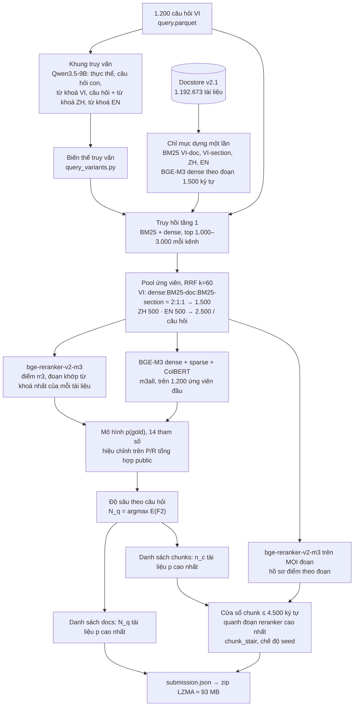

# Thuyết minh sản phẩm — ViBioMIR (R2AI 2026, Stage 3)

**Đội:** Băng Cá Khô · tài khoản Codabench `ca_kho` · cập nhật 02/11/2026

**Bài nộp được báo cáo:** private **#7892** `pN3_base_pqchunks.zip`, đã gắn lên leaderboard private.
Đây là đúng file đã đạt điểm public cao nhất của đội (#7589):

| | FINAL | Docs P / R / F2 | Chunks P / R / F2 |
|---|---|---|---|
| Public #7589 | **0,3484** | 0,2331 / 0,5620 / 0,3964 | 0,1791 / 0,4226 / 0,3004 |

Bốn bài private còn lại (#7893, #7894, #7916, #7917) là các biến thể của cùng hệ thống, mô tả ở mục 1.6.

Tài liệu đi kèm:
- `README.md`: cài đặt, tải dữ liệu và checkpoint, các lệnh chạy lại (yêu cầu 1.5).
- `release/MANIFEST.tsv`: sha256 của mọi file chia sẻ.
- `docs/DATA_CARD.md`: thẻ dữ liệu chi tiết của docstore v2.1.

Mục lục theo hướng dẫn BTC:
- 1.1 Tổng quan hệ thống: mục 1.
- 1.2 Dữ liệu: mục 2.
- 1.3 Mô hình: mục 3.
- 1.4 Mã nguồn: mục 4.
- 1.5 Hướng dẫn: `README.md`.

---

## 1. Tổng quan hệ thống

### 1.1 Ý tưởng

Bài toán: với 1.200 câu hỏi y khoa tiếng Việt, trả về danh sách tài liệu (VI/ZH/EN) và đoạn trích. Điểm là trung bình F2 của docs và F2 của chunks.

F2 coi recall nặng gấp 4 lần precision, và số tài liệu gold mỗi câu hỏi rất khác nhau. Vì thế câu hỏi khó nhất không phải "xếp hạng thế nào" mà là **lấy bao nhiêu tài liệu cho từng câu hỏi**. Hệ thống có ba tầng:

1. **Truy hồi rộng, đa ngữ.** Mỗi câu hỏi lấy 2.500 ứng viên trên ba ngôn ngữ, gồm 1.500 VI, 500 ZH và 500 EN. Nguồn là BM25 và BGE-M3 dense trên chỉ mục dựng sẵn. Một khung truy vấn do Qwen3.5-9B sinh ra cung cấp từ khoá, câu hỏi con và bản dịch ZH/EN.
2. **Ước lượng xác suất liên quan p(gold)** cho từng (câu hỏi, tài liệu), từ thứ hạng ứng viên, điểm cross-encoder bge-reranker-v2-m3 và ba đầu điểm của BGE-M3.
3. **Chọn độ sâu theo từng câu hỏi** bằng cách cực đại F2 kỳ vọng. Chunk là một cửa sổ nguyên văn ≤ 4.500 ký tự, đặt theo hồ sơ điểm reranker trên từng đoạn của tài liệu.

### 1.2 Sơ đồ luồng xử lý



Bản chữ của cùng luồng, kèm tên artifact:

```
query.parquet ─► query frame (Qwen3.5-9B) ─► query_variants ─┐
docstore v2.1 ─► index BM25 (4) + BGE-M3 dense (3 ngôn ngữ) ──┼─► rankings ─► pool5000_vi / ZH / EN RRF
                                                              │      └─► rerank_pool/cands.parquet (2.500/q)
cands ─► rr3 (bge-reranker-v2-m3) ─┬─► pgold_all.py (base2) ─► cands_p.parquet, n_per_query.parquet
cands ─► m3m (BGE-M3 ba đầu)  ─────┘
p, N_q ─► pn3_lists.py ─► lists.parquet (job pN3_base) ─► materialize (Kaggle) ─► pN3_base_pqchunks.zip  (#7892)
cands ─► rr4 (mọi đoạn) ─► pas_scores.parquet ──────────────────┘ (hồ sơ điểm đoạn cho cửa sổ chunk)
```

### 1.3 Xây dựng chỉ mục

Mọi chỉ mục được dựng **một lần** trên docstore v2.1 (Kaggle GPU/CPU). Lúc truy vấn chỉ cần mã hoá câu hỏi.

| Chỉ mục | Đơn vị | Quy mô | Cách dựng |
|---|---|---|---|
| BM25 VI-doc | tài liệu | 732.246 doc, từ vựng 533.407 | `bm25_experiment.py e1 --save-index`; token = âm tiết, giữ dấu; k1 1,5, b 0,75 |
| BM25 VI-section | mục ≤ 4.800 ký tự (heading-aware, tối thiểu 2.000) | 1.208.509 mục | như trên, mức mục |
| BM25 ZH | tài liệu | 220.532 doc | token jieba |
| BM25 EN | tài liệu | 239.895 doc | token từ |
| Dense VI / ZH / EN | đoạn 1.500 ký tự, theo đoạn văn, có tiêu đề ở đầu | 2.224.624 / 557.732 / 337.744 đoạn | BGE-M3, 1.024 chiều, fp16, chuẩn hoá L2 (`dense_embed.py --save-emb`); 4 shard VI gộp bằng `merge_dense_shards.py` |

Điểm tài liệu của dense = cosine lớn nhất trên các đoạn (MaxP). Kernel dựng: `kaggle/kernels_generic/vibiomir-v21-{bm25-*,m3-*}`.

### 1.4 Truy hồi

**Khung truy vấn.** Kernel `vibiomir-query-frame-v3`, model Qwen3.5-9B. Đầu ra là JSON gồm:
- thực thể và bí danh;
- khía cạnh hỏi;
- 1–5 câu hỏi con (`sub0..sub4`);
- từ khoá VI (`kw`);
- câu hỏi dịch sang tiếng Trung (`zh_q`) và từ khoá ZH (`zh_kw`);
- từ khoá EN (`en_kw`);
- đoạn HyDE.

`query_variants.py` biến khung thành các biến thể truy vấn. Đầu ra JSON parse được ở 1.199/1.200 câu hỏi.

**Kênh truy hồi**, mỗi kênh trả top 1.000–3.000:

| Ngôn ngữ | Kênh | Biến thể truy vấn |
|---|---|---|
| VI | BGE-M3 dense, BM25 VI-doc, BM25 VI-section | câu hỏi gốc |
| ZH | BGE-M3 dense | gốc, `zh_q`, `zh_kw` |
| ZH | BM25 ZH | `zh_q`, `zh_kw` |
| EN | BGE-M3 dense | gốc, `en_kw` |
| EN | BM25 EN | gốc, `en_kw` |

**Pool ứng viên** (`scripts/kaggle_ops/lang_pool_sets.py`, `rerank_pool_cands.py`):
- VI: RRF k=60 với trọng số dense : BM25-doc : BM25-section = 2 : 1 : 1, cắt 5.000 (`pool5000_vi`), lấy 1.500 đầu.
- ZH và EN: RRF k=60 trọng số đều trên mọi danh sách (tệp × biến thể) của ngôn ngữ đó, lấy 500 mỗi ngôn ngữ.
- Kết quả: 3.000.000 cặp, đúng 2.500 ứng viên mỗi câu hỏi.

### 1.5 Xếp hạng lại và lựa chọn đầu ra

**Đặc trưng xếp hạng lại.** Tất cả chạy trên Kaggle GPU, chia 4–8 phần.

| Ký hiệu | Model | Phạm vi | Ý nghĩa |
|---|---|---|---|
| `rr3` | bge-reranker-v2-m3 | 2.500 ứng viên/câu hỏi | logit cross-encoder của (câu hỏi, 1 đoạn 1.500 ký tự của tài liệu trùng nhiều từ với câu hỏi nhất, so khớp bỏ dấu); `rerank.py --best-passages 1` |
| `m3all` | BGE-M3 | 1.200 ứng viên đầu (VI 800, ZH 200, EN 200) | 0,4·dense + 0,2·sparse + 0,4·ColBERT, MaxP trên mọi đoạn |
| `rr4` | bge-reranker-v2-m3 | mọi đoạn của 1.200 ứng viên đầu | hồ sơ điểm theo đoạn (4,94 triệu dòng), dùng để đặt cửa sổ chunk |

**Mô hình p(gold).** `scripts/analysis/pgold_all.py`, cấu hình `base2`. Với ứng viên d của câu hỏi q (ngôn ngữ ℓ, hạng r trong ngôn ngữ):

```
logit p(q,d) = a_ℓ + e·log(1+r) + in_pool·( h + b·rr3 + c·m3z + d·m3rel )
```

- `m3z` là m3all đã chuẩn hoá z. `m3rel` = m3z trừ trung bình theo (câu hỏi, ngôn ngữ).
- Số gold kỳ vọng G_q = Σ p / r_cand, với độ lan γ.
- F2 kỳ vọng tính với một nhân tố ngẫu nhiên mức câu hỏi u, E[u] = 1, độ lệch chuẩn σ (`pgold_fit.f2_exp`).

**Hiệu chỉnh.** Có 14 tham số, gồm a_vi/zh/en, e, h, b, c, d, out_vi/zh/en, logit r_cand, γ và σ. Chúng được fit bằng bình phương tối thiểu có cận (`scipy.optimize.least_squares`) sao cho **P/R/F2 docs tổng hợp mà mô hình dự đoán khớp P/R/F2 public** của 27 danh sách tài liệu đội đã nộp. Danh sách các bài này và điểm của chúng nằm trong `runs/reports/pgold_lists/`.

Chỉ dùng **điểm tổng hợp trên leaderboard** của bài của chính đội. Không dùng nhãn từng cặp (câu hỏi, tài liệu) hay từng câu hỏi. Kết quả: γ = 0,536, σ = 0,698.

**Lựa chọn đầu ra** (`scripts/analysis/pn3_lists.py`):
- **Docs:** xếp ứng viên theo p giảm dần. N_q = argmax theo n của E[F2(n)].
  - N_q trung bình 157,4, trung vị 144, p10 77, p90 254, min 20, max 509.
- **Chunks:** một chunk cho mỗi tài liệu trong n_c tài liệu p cao nhất. n_c = argmax E[F2 chunk], với:
  - xác suất chunk khớp p_c = 0,77·p;
  - số gold chunk = 75/71 × số gold doc kỳ vọng.
  - n_c trung bình 162,7, bị chặn bởi giới hạn zip ~100 MB của server.
- **Văn bản chunk** (`r2ai2026/stages/chunk_stair.py`, chế độ `seed`, chạy trong kernel materialize):
  - Một cửa sổ ≤ 4.500 ký tự **trích nguyên văn** từ tài liệu.
  - Tài liệu (tiêu đề + thân bài) ≤ 4.500 ký tự thì lấy trọn.
  - Ngược lại, hạt giống là đoạn có điểm rr4 cao nhất. Cửa sổ nở lần lượt sang đoạn kế sau rồi đoạn kế trước, theo biên đoạn, cho tới khi không thêm được đoạn nào mà vẫn ≤ 4.500 ký tự.
  - Khi thiếu hồ sơ điểm, hạt giống là đoạn trùng nhiều âm tiết với câu hỏi nhất.
  - Độ dài 4.500 được chọn bằng thí nghiệm public: cửa sổ 1.500 / 3.000 / 4.500 / 6.000 / 7.500 cho chunks F2 lần lượt 0,094 / 0,225 / 0,235 / 0,235 / 0,235. Tức là bão hoà từ 4.500.
- **Đóng gói:** `submission.json` (id, relevant_docs, relevant_chunks), nén LZMA, 92,6 MB.

### 1.6 Năm bài private

| Mã | File | Khác bài chính ở đâu | docs/q | chunks/q |
|---|---|---|---|---|
| **#7892** | `pN3_base_pqchunks.zip` | **bài chính**, như trên | 157,4 | 162,7 |
| #7893 | `S1_dqd20.zip` | thêm 20 tài liệu/câu hỏi từ doc2query dense | 177,4 | 162,7 |
| #7894 | `S2_dqb20.zip` | thêm 20 tài liệu/câu hỏi từ doc2query BM25 | 177,4 | 162,7 |
| #7916 | `N1_n125.zip` | docs sâu 1,25·N_q | 196,7 | 162,7 |
| #7917 | `F2_dqd20b20g.zip` | thêm 20 dense + 20 BM25 doc2query trên toàn bộ tài liệu, có cổng đuôi | 197,4 | 162,7 |

Doc2query (`scripts/analysis/dq_lists.py`):
- Qwen3.5-4B sinh 3 câu hỏi tiếng Việt cho mỗi tài liệu, từ đoạn reranker tốt nhất. Tổng 564.606 câu cho 189.227 tài liệu.
- Kênh dense: cosine BGE-M3 lớn nhất giữa câu hỏi thi và các câu sinh ra.
- Kênh BM25: BM25 trên các câu sinh ra, k1 1,2, b 0,75.
- Tài liệu chưa có trong danh sách thì nối vào cuối. Mỗi tài liệu thêm thay một chunk p thấp nhất, nên số chunk giữ nguyên.

---

## 2. Dữ liệu

### 2.1 Nguồn

- **Dữ liệu BTC:** `query.parquet` (1.200 câu hỏi) và `links_corpus_vi_en_zh.parquet` (1.220.598 URL chính thức; id chia khối VI ≤ 766.441 < ZH ≤ 4.392.214 < EN).
- **Nội dung tài liệu:** chỉ gồm tài liệu thuộc danh sách URL chính thức. Có 0 tài liệu ngoài danh sách.

| Nguồn | Số tài liệu | Cách lấy |
|---|---|---|
| crawl nội bộ | 1.182.666 | crawler của đội trên danh sách URL chính thức (`r2ai2026/crawl/`), đóng băng 20/10/2026 |
| HF `tmh1008/ViBioMIR-crawled-corpus` @ `18cb5a544322d8d7b903ca2b6ceb3138628223b4` | 5.760 thêm, 4.475 thay thân bài VI | bộ crawl công khai của cùng danh sách URL; chỉ dùng làm văn bản, qua cổng chất lượng |
| Common Crawl (CDX / columnar) | 2.278 | cứu URL chết |
| Internet Archive Wayback | 1.400 | cứu URL chết (`r2ai2026/crawl/wayback.py`) |
| recrawl trực tiếp | 370 | |
| NCBI E-utilities (PubMed) | 177 | chỉ EN (`r2ai2026/crawl/pubmed.py`) |
| Long Châu recrawl | 22 | |
| **Tổng docstore v2.1** | **1.192.673** | VI 732.246 · ZH 220.532 · EN 239.895; 27.925 URL chính thức vẫn thiếu (403, rỗng) |

### 2.2 Làm sạch

Thực hiện bởi `scripts/data/build_docstore*.py` và `r2ai2026/corpus/`. Chi tiết trong `docs/DATA_CARD.md` và `docs/DATA_PIPELINE.md`.

1. **Hợp nhất:** mỗi id một bản ghi. Ưu tiên crawl gốc nếu qua lọc rác; nếu không thì direct > wayback > cc > pubmed, rồi chọn bản dài nhất.
2. **Lọc rác:** loại trang lỗi, 404, trang chủ hay trang bị trả trùng cho nhiều URL. Ngưỡng trùng đếm trên toàn bộ nguồn.
3. **Chuẩn hoá:** NFKC, giải mã HTML entity, gộp khoảng trắng. Văn bản **không bị viết lại**.
   - Phần khung trang (menu, footer, tham khảo, CTA…) được **đánh dấu** thành span "furniture" theo mẫu từng host (`furniture.parquet`, `templates.json`), không xoá.
4. **Metadata:** ngôn ngữ, host, `content_key` (trùng nội dung, `dup_of`), cờ thin < 500 ký tự.
5. **Kiểm tra độc lập:** `scripts/data/validate_docstore.py` → `validation.json`: 0 lỗi, 1 cảnh báo (5 thân bài rỗng được giữ để không mất id).

### 2.3 Phân đoạn

- **Đoạn** (`passages.parquet`, 3.607.930 đoạn): theo đoạn văn, đích 1.500 ký tự, phủ kín thân bài, không chồng nhau. Có offset `start/end` trên thân bài.
- **Mục** (`sections.parquet`, 1.654.080 mục): theo heading, tối đa 4.800 ký tự.
- Chunk nộp là cửa sổ ghép từ các đoạn liền nhau mà reranker đã chấm (theo dòng văn bản, `rr_spans` trong `kaggle/pinned/chunk-v21-assets/build_submission.py`), tổng ≤ 4.500 ký tự. Vì vậy `chunk_text` luôn là lát cắt nguyên văn của tài liệu.

### 2.4 Truy cập dữ liệu

Toàn bộ dữ liệu được chia sẻ qua thư mục Google Drive: **https://drive.google.com/drive/folders/1_VUdqZ4eTv9w_hHRPDWsLLNNmqxyYDaj?usp=sharing** (quyền xem cho người có link). Nội dung và sha256 của từng file nằm trong `MANIFEST.tsv`.

| Gói | Dung lượng | Nội dung | Cần cho |
|---|---|---|---|
| `vibiomir_code_<commit>.zip` | 5 MB | mã nguồn (git archive) | mọi bước |
| `artifacts_A_pgold.zip` | 246 MB | pool ứng viên, rr3, m3m, danh sách đã chấm + điểm public, đầu ra p(gold) base2, lists của 5 bài | dựng lại 5 danh sách nộp (CPU) |
| `artifacts_B_materialize.zip` | 59 MB | hồ sơ điểm đoạn rr4 (`pas_scores`), bản mã materialize cố định (`chunk_v21_assets`) | dựng văn bản chunk và zip |
| `artifacts_C_doc2query.zip` | 84 MB | câu hỏi doc2query, điểm dense và BM25 | bài #7893/#7894/#7917 |
| `artifacts_D_retrieval.zip` | 696 MB | khung truy vấn, biến thể, mọi ranking tầng 1, tập pool theo ngôn ngữ | dựng lại pool ứng viên |
| `docstore_v2.1/` | 1,4 GB | `corpus/part-*.jsonl.gz` (`{id,url,t,x}`), `docs_meta`, `passages`, `sections`, `furniture`, MANIFEST | materialize và mọi bước GPU |
| `index_v2.1/` | 10,4 GB | BM25 (4 chỉ mục) + embedding BGE-M3 fp16 | truy hồi tầng 1 (có thể dựng lại) |

Cách dùng: giải nén các gói `artifacts_*.zip` **tại thư mục gốc repo** (đường dẫn bên trong là đường dẫn tương đối của repo). Đặt `docstore_v2.1/` vào `data/docstore/v2.1/` và `index_v2.1/` vào `data/docstore/v2.1/index/`.

Bản sao trên Kaggle (dùng trong kernel): `tthiutoko/vibiomir-docstore-v21`, `tthiutoko/vibiomir-v21-index`, `tthiutoko/vibiomir-chunk-v21-assets`, `tthiutoko/vibiomir-pas-scores`, `tthiutoko/vibiomir-mat-lists22`.

**Giới hạn sử dụng:** văn bản crawl thuộc bản quyền các website gốc. Bộ dữ liệu chỉ chia sẻ cho BTC để kiểm tra và tái lập, không phát hành công khai (`docs/DATA_CARD.md` §5).

---

## 3. Mô hình

Tất cả là mô hình mã nguồn mở, ≤ 15B tham số, phát hành trước 01/08/2026, tải từ Hugging Face Hub. **Không dùng API hay mô hình đóng nào.** Không fine-tune: mọi checkpoint dùng nguyên bản.

| Mô hình | Vai trò | Tham số | Revision (commit HF) | Phát hành | License |
|---|---|---|---|---|---|
| [BAAI/bge-m3](https://huggingface.co/BAAI/bge-m3) | embedding đoạn và câu hỏi (dense), m3all (dense + sparse + ColBERT), embedding doc2query | 0,57B | `5617a9f61b028005a4858fdac845db406aefb181` | 27/01/2024 | MIT |
| [BAAI/bge-reranker-v2-m3](https://huggingface.co/BAAI/bge-reranker-v2-m3) | rr3 (đoạn tốt nhất), rr4 (mọi đoạn → cửa sổ chunk) | 0,57B | `953dc6f6f85a1b2dbfca4c34a2796e7dde08d41e` | 15/03/2024 | Apache-2.0 |
| [Qwen/Qwen3.5-9B](https://huggingface.co/Qwen/Qwen3.5-9B) | khung truy vấn (từ khoá, câu hỏi con, bản dịch ZH/EN, HyDE) | 9,65B | `c202236235762e1c871ad0ccb60c8ee5ba337b9a` | 27/02/2026 | Apache-2.0 |
| [Qwen/Qwen3.5-4B](https://huggingface.co/Qwen/Qwen3.5-4B) | sinh câu hỏi doc2query (chỉ bài #7893/#7894/#7917) | 4,66B | `851bf6e806efd8d0a36b00ddf55e13ccb7b8cd0a` | 27/02/2026 | Apache-2.0 |

- Các kernel tải `main` lúc chạy (20/10–01/11/2026). Lần sửa cuối trên Hub của bốn repo là 24/06/2024, 03/07/2024 và 02/03/2026, đều trước ngày chạy. Vì vậy revision ở bảng là đúng bản đã dùng.
- Tải: `huggingface-cli download <repo> --revision <sha>`, hoặc để `transformers`/`sentence-transformers` tự tải khi chạy.

**Cấu hình suy luận:**

| Model | Thư viện | Cấu hình |
|---|---|---|
| BGE-M3 dense | `sentence-transformers` | fp16, đoạn 1.500 ký tự có tiêu đề |
| BGE-M3 ba đầu (m3all) | `r2ai2026/stages/m3_multi.py` | trọng số 0,4 / 0,2 / 0,4 |
| bge-reranker-v2-m3 | `transformers` `AutoModelForSequenceClassification` | fp16, batch 32 |
| Qwen3.5 | `transformers` | fp16; `enable_thinking=False`; giải mã tham lam (`do_sample=False`), nên không có temperature hay seed |

**Prompt:**

| Bước | System prompt | User message | Tham số |
|---|---|---|---|
| Khung truy vấn | `r2ai2026/stages/query_frame.py:34-49` | nguyên văn câu hỏi | `max_new_tokens` 1.300, batch 16 |
| Doc2query | `r2ai2026/stages/doc2query.py:36-42` | `TITLE / SECTION / PASSAGE`, `doc2query.py:43` | 3 câu/tài liệu, `max_new_tokens` 200, đoạn cắt 1.100 ký tự, batch 16 |

Bản đúng từng ký tự nằm trong `run.py` của kernel tương ứng: `vibiomir-query-frame-v3-acc1`, `vibiomir-dq-g-acc*`, `vibiomir-dqt-p*`.

Đầu ra của hai bước sinh văn bản (`query_frame.parquet`, `questions.parquet`) được chia sẻ như dữ liệu chuẩn. Chạy lại trên phần cứng hoặc phiên bản thư viện khác có thể lệch vài token dù giải mã tham lam.

---

## 4. Mã nguồn

Mã nằm trong repo này (gói `vibiomir_code_<commit>.zip`, `git archive` của commit đã nộp).

| Thành phần | Đường dẫn |
|---|---|
| Thư viện lõi: định dạng bài nộp, chấm điểm nội bộ, docstore, crawler | `r2ai2026/core/`, `r2ai2026/corpus/`, `r2ai2026/crawl/` |
| Script từng stage (chạy trên Kaggle) | `r2ai2026/stages/`: `query_frame.py`, `query_variants.py`, `bm25_experiment.py`, `dense_embed.py`, `dense_search.py`, `rerank.py`, `m3_multi.py`, `doc2query.py`, `chunk_stair.py` |
| Dựng docstore | `scripts/data/` |
| Pool ứng viên | `scripts/kaggle_ops/lang_pool_sets.py`, `rerank_pool_cands.py` |
| p(gold) và danh sách nộp | `scripts/analysis/pgold_fit.py`, `pgold_all.py`, `decide_lists.py`, `pn3_lists.py`, `sub_doc_lists.py` |
| Doc2query | `scripts/kaggle_ops/doc2query_inputs.py`, `scripts/analysis/dq_prepare.py`, `doc2query_score.py`, `dq_bm25.py`, `dq_lists.py` |
| Kernel Kaggle đã chạy | `kaggle/kernels_generic/vibiomir-*/` |
| Bản mã materialize cố định | `kaggle/pinned/chunk-v21-assets/` (CODE_VERSION `06f71bf-dirty`) |
| Phát hành và kiểm tra | `scripts/release/pack_release.py`, `check_lists.py`, `extract_bundle.py` |
| Thư viện | `requirements.txt` (CPU), `requirements-gpu.txt` (GPU) |
| Kiểm thử | `tests/` (pytest) |

Mỗi kernel Kaggle mang theo nguyên văn mã của stage nó chạy, gồm biến `SRC`, các module phụ, gói pip và danh sách tham số. Vì vậy **thư mục kernel là bản ghi chính xác của lần chạy sản xuất**. `scripts/release/extract_bundle.py` xuất mã đó ra file để đọc hoặc chạy ngoài Kaggle.

Đã so mã nhúng trong kernel với `r2ai2026/stages/` của commit nộp:
- Giống hệt: `query_frame.py` (kernel khung truy vấn), `doc2query.py` (kernel `dqt-p*`), `m3_multi.py`, `dense_search.py`, `bm25_experiment.py` (kernel `qv3-bm25-*`).
- Kernel `dq-g-*` chỉ thiếu đoạn chia nhiều GPU; prompt giống hệt.
- Kernel `rr3-p*` có thêm tuỳ chọn `--best-passages`, không có trong `r2ai2026/stages/rerank.py` của commit.
- Kernel `v21-m3-*` khác `dense_embed.py` ở cây làm việc.

Khi tái lập các stage này, dùng mã trong kernel.

### 4.1 Kiểm chứng tái lập

Chạy ngày 02/11/2026 trong thư mục trống, chỉ có gói mã và các gói dữ liệu, không dùng cây làm việc của đội:

| Bước | So với | Kết quả |
|---|---|---|
| `pn3_lists.py` từ p(gold) base2 đã chia sẻ | lists của #7892 (pN3_base) và #7916 (N1_n125) | khớp từng dòng, 1.200/1.200 câu hỏi |
| `dq_lists.py` | lists của #7893, #7894, #7917 | khớp từng dòng |
| `pgold_all.py --exclude …` fit lại từ đầu (3,5 phút CPU) | p(gold) base2 | p lệch ≤ 1,1·10⁻⁵. Tập docs khớp ở 1.199/1.200 câu hỏi (q785 thêm 1 doc); tập chunks khớp 1.200/1.200 |
| `lang_pool_sets.py` + `rerank_pool_cands.py` từ các ranking đã chia sẻ | `rerank_pool/cands.parquet` | khớp hoàn toàn 3.000.000 cặp |
| `query_variants.py` từ khung truy vấn đã chia sẻ | `query_variants.parquet` | khớp hoàn toàn 12.531 dòng |
| nối `rr4-p*/passages.parquet` | `pas_scores.parquet` | khớp hoàn toàn 4.942.553 dòng |
| 5 zip đã nộp | lists tương ứng | thứ tự `relevant_docs` và doc_id của chunk khớp ở 1.200/1.200 câu hỏi |

Các stage GPU (khung truy vấn, ranking, rr3/m3m/rr4, doc2query) chạy lại được bằng chính các kernel trong `kaggle/kernels_generic/`. Đầu ra của chúng được chia sẻ (gói A, B, C, D), nên người kiểm tra không cần GPU để dựng lại bài nộp.

---

## 5. Cam kết tuân thủ và công bố

- **Không dùng MedKB của BTC trong hệ thống.** Đầu cuộc thi (19–20/10) đội có một lần thăm dò MedKB. Lần đó chỉ ghi lại thống kê tổng hợp (độ dài chunk trung vị ~3,3k ký tự, tối đa ~4,8k). Không nội dung, kết quả hay trường `similar_queries` nào của MedKB đi vào bài nộp, và không gọi API MedKB khi chạy.
- **Thống kê gold.** Hai số tổng hợp được dùng: |gold| trung bình 71 tài liệu / 75 chunk mỗi câu hỏi, và tập public = 600/1.200 câu hỏi. Chúng được đọc từ một tệp kết quả của bộ chấm chính thức có trên GitHub công khai. Hệ thống chỉ dùng tỉ số 75/71 (trong `pn3_lists.py`), không dùng nhãn từng cặp hay từng câu hỏi.
- **Leaderboard.** Chỉ dùng P/R/F2 tổng hợp trên tập public của các bài đội đã nộp, để hiệu chỉnh p(gold) và độ sâu N_q.
- Không có tài liệu ngoài danh sách URL chính thức.
